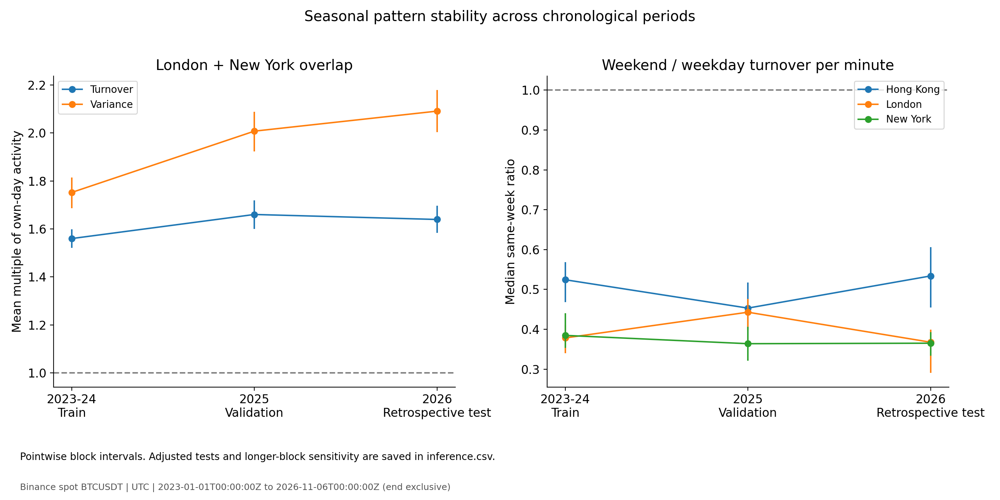

# BTC/USDT Trading Patterns

This is my submission for **Option B** of the 21Shares take-home: find trading patterns in BTC/USDT 1-second candles from January 2023 onwards.

I used Binance Spot data from **1 January 2023 to 5 November 2026** (end exclusive: `2026-11-06T00:00:00Z`). The project covers downloading the data, checking it, and analysing trading activity, volatility and short-term price movements.

**Start here:** [Presentation](presentation/BTC-21shares.pdf) · [Research charts](results/analysis/figures) · [Research tables](results/analysis/tables) · [Quality report](results/quality/quality.json) · [Data dictionary](docs/DATA_DICTIONARY.md)

## What I found

A few results stood out in the full sample:

| Pattern | Result |
|---|---|
| Busy hours | 14:00–16:00 UTC accounts for 13.91% of daily BTC volume and 16.66% of daily realised variance on average. |
| London–New York overlap | Turnover and variance per minute are 1.60× and 1.89× their respective daily averages. |
| Weekends | Median within-week weekend/weekday ratios are 0.463 for BTC volume and 0.548 for daily realised volatility. |
| Volatility clustering | The lag-1 correlation of absolute 1-minute returns is 0.383, while signed-return correlation is near zero. |
| Taker imbalance | Correlation with same-minute returns is 0.421, but only 0.0125 with next-minute returns. |

The overlap effect, absolute-return persistence and lower weekend turnover within regional windows hold up across the three chronological periods under both block-length checks. Short-horizon forecasting is much less convincing: the next-minute imbalance relationship fails the longer-block adjusted test in 2026, and the simple return models do not show a robust MSE improvement in that period.



These are **observed patterns, not trading signals or claims of profitability**. The 2026 period is a *retrospective* test because I had already inspected some of its data before fixing the validation design.

## How the code works

The pipeline is deliberately split into a few small parts:

| File | What it does |
|---|---|
| `run.py` | CLI, config and task selection |
| `download.py` | Fetches API pages, caches responses, writes daily Parquet files and resumes interrupted downloads |
| `quality.py` | Checks files, timestamps and OHLCV consistency |
| `analysis.py` | Builds aggregates, runs the pattern analysis and validation, and produces charts |
| `scripts/eda.py` | Builds additional descriptive charts from saved analysis tables |
| `tests/test_run.py` | Offline tests for downloads, checks and calculations |

The raw responses are cached before conversion. Data is processed **one day at a time**, saved as Zstd-compressed Parquet, and read back as needed. This keeps memory usage manageable without loading years of second-level data at once. Each daily partition has a receipt recording its source, time range and SHA-256 hash.

The repository includes saved outputs in `results/`. Raw downloads, caches, virtual environments, logs and working files are not committed. New runs write to `reports/`.

## Run it

Tested on Windows using **Python 3.9.21**; supported Python versions are 3.9–3.12.

```powershell
python -m venv .venv
.\.venv\Scripts\python.exe -m pip install -r requirements-dev.txt
```

Activate the environment, or use its Python executable for the commands below (`.venv/bin/python` on macOS/Linux).

```powershell
# See what the one-day demo would request (no API calls)
python run.py --config configs/demo.json plan

# Download and check one day
python run.py --config configs/demo.json run

# Run the complete download and checks
python run.py --config configs/full.json run

# Check files already on disk
python run.py --config configs/full.json check

# Run the research
python analysis.py --config configs/full.json

# Make the extra descriptive charts
python scripts/eda.py

# Offline tests
python -m pytest -q
```

`run` means `fetch` followed by `check`; `fetch` also works on its own. Downloads can resume from cached pages, and completed partitions are reused when their hashes match. Date and path overrides are available with `--start`, `--end`, `--data-dir` and `--report-dir`; analysis also supports `--output-dir`.

The full period requires **at least 122,235 API requests**. At the default pacing, that is roughly **8.49 hours before network latency, retries and processing**. Try `configs/demo.json` first. It tests the pipeline, but a single day cannot reproduce the multi-year findings.

To rebuild only the descriptive figures from committed results, copy `results/analysis/tables/` to `reports/full/analysis/tables/` and run `python scripts/eda.py`.

## Data checks

Source: Binance Spot [`/api/v3/klines`](https://github.com/binance/binance-spot-api-docs/blob/master/rest-api.md), `BTCUSDT`, `1s`, using `https://data-api.binance.vision` without an API key. Requests use UTC `[start, end)` windows. **REST timestamps are milliseconds**; I convert them to UTC and store timestamps at microsecond precision. The downloader does not import Binance historical ZIP files, which have a different timestamp convention from 2025 onwards.

The checker looks for bad file hashes, missing/duplicate/off-grid/out-of-order timestamps, invalid or inconsistent prices and volumes, bad OHLC ordering, incorrect close times and taker-volume inconsistencies. Zero-volume candles are kept; they are not treated as missing data.

| Full-run check | Result |
|---|---:|
| Daily partitions | 1,405 |
| Expected / observed seconds | 121,392,000 / 121,387,182 |
| Timestamp coverage | 99.996031% |
| Missing seconds | 4,818, all within the known gap |
| Unexpected missing seconds | 0 |
| Zero-volume seconds observed | 8,833,704 |
| Complete analysis days / comparison weeks | 1,404 / 199 |

The final audit is **`WARNING` rather than `PASS`** because of one known gap: `2023-03-24 12:39:42 UTC` to `14:00:00 UTC` (4,818 seconds). The jump is present in a cached REST response, a repeated request and the official daily archive. Binance reported a [spot trading halt](https://www.binance.com/en/blog/from-our-ceo/6789340645608890113) and a [14:00 UTC recovery](https://www.binance.com/en/support/announcement/detail/813a31506e9f478ea8c1058b425df87a).

There are also 4,338 recorded zero-trade/zero-volume candles from 11:27:24 to 12:39:41 UTC, before the missing interval. The published incident information does not explain the difference. The [official daily ZIP](https://data.binance.vision/data/spot/daily/klines/BTCUSDT/1s/BTCUSDT-1s-2023-03-24.zip) (checked against its [checksum](https://data.binance.vision/data/spot/daily/klines/BTCUSDT/1s/BTCUSDT-1s-2023-03-24.zip.CHECKSUM)) contains the same unique timestamps, plus 36 identical duplicate rows. I kept the REST dataset as the source of record.

The known gap is explicitly allowed as a warning, not filled in. Any other missing timestamps, invalid data or untrusted partitions cause a `FAIL`. Returns do not cross gaps, and analysis stops on `FAIL`.

## Analysis and validation

I use log returns and realised volatility calculated from adjacent seconds. Daily realised volatility is `100 * sqrt(sum(second_log_return ** 2))`, without annualisation. Minute-level returns need two complete adjacent minutes.

For activity patterns, I normalise within each complete UTC day before averaging, so a handful of high-volume days do not dominate the intraday profile. Weekend comparisons use complete Monday–Sunday weeks. Hong Kong, London and New York windows are defined as **09:00–17:00 local time**, including historical daylight-saving rules where applicable. These are *time windows*, **not the actual locations of traders**, and some windows overlap.

For the short-horizon work, I compare signed- and absolute-return autocorrelation and use taker imbalance:

`imbalance = 2 * taker_buy_quote_volume / quote_volume - 1`

Imbalance is undefined when quote volume is zero. I keep its **same-minute association** separate from any relationship with **future** returns. Full-day normalisation and full-sample extreme-day thresholds are descriptive only, not inputs to forecasts.

The forecast exercise is small by design:

| Period | Role |
|---|---|
| 2023–2024 | Fit feature scaling and linear-model parameters |
| 2025 | Choose a model for each horizon using MSE |
| 2026 through 5 November | Retrospective evaluation with the selected training parameters frozen |

I test **1-, 5- and 15-minute horizons**, comparing a training-mean baseline, a return-only linear model and an imbalance-only linear model. Signals use completed minutes, and targets cannot cross gaps or period boundaries. The reported improvement is `100 * (1 - model_MSE / baseline_MSE)`; it is **not a trading P&L**.

Since adjacent forward-return labels overlap, I do not treat each minute as an independent observation. Inference uses circular calendar-block bootstrap with **7/28-day blocks** for daily statistics and **4/8-week blocks** for weekly statistics, **1,999 draws**, seed **42**. The checks use basic bootstrap intervals and approximate centred two-sided p-values; Holm correction is applied across **39 planned checks** per stage and block setting. A finding counts as supported only if the adjusted p-value is below 0.05 and the effect direction agrees under both block lengths. Detailed outputs are in `results/analysis/tables/`, including `inference.csv` (234 checks across stages/settings), `feature_audit.csv`, `forecast_scores.csv` and `forecast_models.csv`.

## Outputs and practical notes

- `results/quality/`: audit, per-day checks and missing intervals
- `results/analysis/tables/`: hourly activity, regional windows, weekend ratios, correlations, forecasts and validation
- `results/analysis/figures/`: the main research charts
- `results/analysis/summary.json`: run details, coverage and analysis settings
- `results/eda/`: distributions, heatmaps, volatility calendar and other descriptive plots

The main analysis produces **22 CSV tables and 14 figures**; EDA adds **3 CSV tables and 5 figures**. Yearly/monthly results use actual data coverage: **2026 is partial**, and November contains only five days.

If a download is interrupted, rerun the same command. If a hard kill leaves `data/<run>/.writer.lock`, make sure its PID is no longer running before deleting the lock. A hash mismatch stops the process; keep the affected file for inspection and rebuild from trusted cached pages. Exit codes are `0` (success or accepted warning), `1` (runtime/config issue), `2` (quality failure or invalid CLI), and `130` (interrupted).

**Limits:** This is one exchange's trade data, not a global BTC tape. Candles do not show order-book depth, spread, trader location or the ordering of individual trades within a second. The persistence estimates do not fully remove intraday seasonality. I have not implemented forward volume-to-volatility forecasts or post-event recovery analysis. A genuinely untouched test would require freezing the method **before** collecting new observations.

For API details, see the [Binance REST documentation](https://github.com/binance/binance-spot-api-docs/blob/master/rest-api.md) and [public market-data FAQ](https://github.com/binance/binance-spot-api-docs/blob/master/faqs/market_data_only.md). Source data remains subject to the provider's terms.
